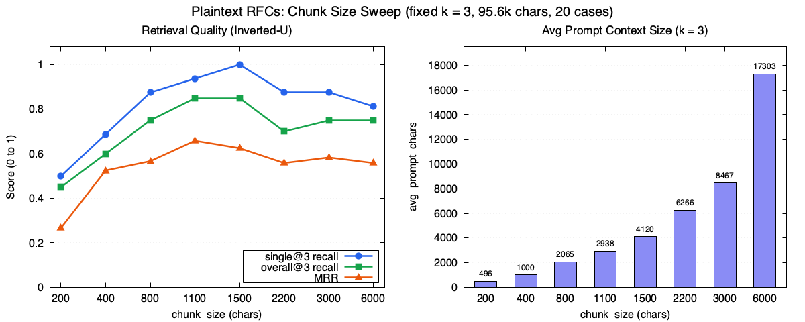

# Experiment 1: Chunk Size Curve (fixed `k = 3`)

Chunker: `Plain` (paragraph packing, no structure). Measured on the [shared RFC corpus](../README.md) (3 RFCs, 95,595 chars, 20 questions). Data: [chunk_size.csv](chunk_size.csv) · Chart: `gnuplot experiments/01-chunk-size/plot.gp` · Runner: `cargo test --test sweep sweep_chunk_size -- --ignored --nocapture` in [tests/sweep.rs](../../tests/sweep.rs)

| `chunk_size` | `chunks` | `single@3` | `overall@3` | `MRR` | `avg_prompt_chars` | `ingest` |
| ---: | ---: | ---: | ---: | ---: | ---: | ---: |
| 200 | 632 | 8/16 (50%) | 9/20 (45%) | 0.267 | 496 | 11.0s |
| 400 | 320 | 11/16 (69%) | 12/20 (60%) | 0.525 | 1,000 | 3.0s |
| 800 | 148 | 14/16 (88%) | 15/20 (75%) | 0.567 | 2,065 | 1.7s |
| **1100** | **105** | **15/16 (94%)** | **17/20 (85%)** | **0.658** | **2,938** | **2.3s** |
| **1500** | **76** | **16/16 (100%)** | **17/20 (85%)** | **0.625** | **4,120** | **1.5s** |
| 2200 | 49 | 14/16 (88%) | 14/20 (70%) | 0.558 | 6,266 | 1.6s |
| 3000 | 35 | 14/16 (88%) | 15/20 (75%) | 0.583 | 8,467 | 1.4s |
| 6000 | 17 | 13/16 (81%) | 15/20 (75%) | 0.558 | 17,303 | 1.4s |

**Takeaways:**
- **Too small (`200–400` chars):** paragraphs fragment into ambiguous slices (`single@3` drops to 50%, `MRR` to `0.267`), spawning 632 chunks (`11.0s` ingest).
- **Sweet spot (`1100–1500` chars ≈ ~275–375 tokens):** `1100` peaks on `MRR` (`0.658`) with 29% fewer prompt chars than `1500`; `1500` peaks on `single@3` (`16/16 = 100%`), both tying on `overall@3` (`17/20 = 85%`).
- **Too large (`2200–6000` chars):** dilution hits already at `2200` (`overall@3` falls from `85% → 70%`, `MRR` from `0.658 → 0.558`), and by `6000` prompt size is **5.9×** larger than `1100` (`17,303` vs `2,938` chars) for worse retrieval.
