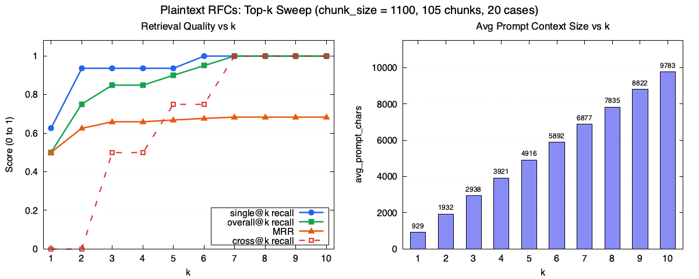

# Experiment 2: Top-`k` Curve (fixed `chunk_size = 1100`)

Chunker: `Plain` (paragraph packing, no structure). Measured on the [shared RFC corpus](../README.md) (3 RFCs, 95,595 chars, 20 questions); metrics are defined [there](../README.md#metrics). Data: [top_k.csv](top_k.csv) · Chart: `gnuplot experiments/02-top-k/plot.gp` · Runner: `cargo test --test sweep sweep_k -- --ignored --nocapture` in [tests/sweep.rs](../../tests/sweep.rs)

Fixing `chunk_size` at [Experiment 1](../01-chunk-size/README.md)'s MRR winner (`1100` chars) and sweeping `k = 1..=10`:

| `k` | `single@k` | `cross@k` | `overall@k` | `MRR` | `avg_prompt_chars` |
| ---: | ---: | ---: | ---: | ---: | ---: |
| 1 | 10/16 (63%) | 0/4 (0%) | 10/20 (50%) | 0.500 | 929 |
| 2 | 15/16 (94%) | 0/4 (0%) | 15/20 (75%) | 0.625 | 1,932 |
| **3** | **15/16 (94%)** | **2/4 (50%)** | **17/20 (85%)** | **0.658** | **2,938** |
| 4 | 15/16 (94%) | 2/4 (50%) | 17/20 (85%) | 0.658 | 3,921 |
| 5 | 15/16 (94%) | 3/4 (75%) | 18/20 (90%) | 0.668 | 4,916 |
| 6 | 16/16 (100%) | 3/4 (75%) | 19/20 (95%) | 0.677 | 5,892 |
| **7** | **16/16 (100%)** | **4/4 (100%)** | **20/20 (100%)** | **0.684** | **6,877** |
| 8 | 16/16 (100%) | 4/4 (100%) | 20/20 (100%) | 0.684 | 7,835 |
| 9 | 16/16 (100%) | 4/4 (100%) | 20/20 (100%) | 0.684 | 8,822 |
| 10 | 16/16 (100%) | 4/4 (100%) | 20/20 (100%) | 0.684 | 9,783 |

**Takeaways:**
- **Steep knee at `k = 1 → 3`:** `overall` jumps `50% → 75% → 85%` (`single` hits `15/16` by `k = 2`), and `k = 3` already captures **96% of final MRR** (`0.658 / 0.684`) at `2,938` prompt chars.
- **Diminishing returns (`k = 3 → 7`):** reaching `20/20 (100%)` (including all `4/4` cross-chunk cases) costs **2.3× more prompt chars** (`2,938 → 6,877`) for `+0.026` MRR.
- **Pure noise past saturation (`k = 7 → 10`):** prompt context grows another **+42%** (`6,877 → 9,783` chars) with zero recall or MRR gain.
