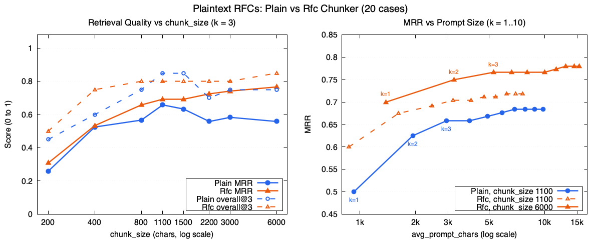

# Experiment 3: `Plain` vs `Rfc` Chunker (`chunk_size` × `k` grid)

Measured on the [shared RFC corpus](../README.md) (3 RFCs, 95,595 chars, 20 questions); metrics are defined [there](../README.md#metrics). Data: [chunker.csv](chunker.csv) · Chart: `gnuplot experiments/03-chunker/plot.gp` · Runner: `cargo test --test sweep sweep_chunker -- --ignored --nocapture` in [tests/sweep.rs](../../tests/sweep.rs)

`Rfc` packs paragraphs exactly like `Plain`, except that a section heading always starts a new chunk. Headings are found from layout alone, the way a reader spots them: a short standalone block that sticks out left of the body indent, doesn't end like a sentence, and isn't a page header/footer repeated across pages (no numbering patterns or title lists). On these three RFCs it finds exactly the 23 + 31 + 36 section titles (`rfc_headings_match_fixture_sections`). Page headers/footers stay inside chunks for both chunkers, so headings are the only difference.

Each (chunker, `chunk_size`) is embedded once and retrieved at `k = 10`; every smaller `k` is scored from the same ranking (`sweep_chunker`, 160 rows in `chunker.csv`).

At `k = 3`:

| `chunk_size` | `Plain` chunks (avg chars) | `Rfc` chunks (avg chars) | `Plain` `overall@3` | `Rfc` `overall@3` | `Plain` `MRR` | `Rfc` `MRR` | `Plain` prompt chars | `Rfc` prompt chars |
| ---: | ---: | ---: | ---: | ---: | ---: | ---: | ---: | ---: |
| 200 | 632 (150) | 659 (143) | 9/20 | 10/20 | 0.258 | 0.308 | 496 | 494 |
| 400 | 320 (297) | 358 (265) | 12/20 | 15/20 | 0.525 | 0.533 | 1,000 | 883 |
| 800 | 148 (643) | 185 (515) | 15/20 | 16/20 | 0.567 | 0.658 | 2,065 | 1,745 |
| **1100** | 105 (908) | 147 (648) | **17/20** | 16/20 | **0.658** | 0.692 | 2,938 | 2,455 |
| 1500 | 76 (1,255) | 119 (801) | 17/20 | 16/20 | 0.633 | 0.692 | 4,120 | 2,944 |
| 2200 | 49 (1,948) | 102 (935) | 14/20 | 16/20 | 0.558 | 0.725 | 6,266 | 3,634 |
| 3000 | 35 (2,729) | 90 (1,060) | 15/20 | 16/20 | 0.583 | 0.742 | 8,467 | 4,611 |
| **6000** | 17 (5,620) | 87 (1,097) | 15/20 | **17/20** | 0.558 | **0.767** | 17,303 | 5,276 |

Top-1 hits on the 16 single-chunk cases (`single@1`):

| `chunk_size` | 200 | 400 | 800 | 1100 | 1500 | 2200 | 3000 | 6000 |
| --- | ---: | ---: | ---: | ---: | ---: | ---: | ---: | ---: |
| `Plain` | 3 | 9 | 8 | 10 | 9 | 9 | 9 | 8 |
| `Rfc` | 4 | 7 | 11 | 12 | 12 | 13 | 14 | 14 |

**Takeaways:**
- **Sections make better chunks than packed paragraphs:** from `chunk_size = 800` up, `Rfc` ranks the evidence higher at every size (`MRR` `+0.03` to `+0.21`), mostly by putting it first: `single@1` reaches `14/16` against `Plain`'s best of `10/16`.
- **No dilution, so bigger is better for `Rfc`:** `Plain` peaks at `1100` and then degrades as chunks merge unrelated paragraphs. `Rfc` never merges across sections, so past `~2200` its chunks converge to one section each (`~1,100` chars on average at `6000`), and its `MRR` keeps rising to `0.767`. Splitting on sections and letting each section be one chunk beats packing.
- **Cross-chunk questions are `Rfc`'s weak spot:** at `k = 3` both chunkers get `0–2/4` cross-chunk cases, but raising `k` recovers them for `Plain` (`4/4` by `k = 7` at `1100`, `6,877` chars) while `Rfc` mostly stalls at `2–3/4`, reaching `20/20` only at `chunk_size 2200–3000` with `k = 10` (`11–14k` prompt chars). Answers spanning two passages often sit in different sections, which `Rfc` never shares a chunk between, and the second section has to win a top-`k` slot on its own.
- **Same prompt budget, better ranking, one fewer answer:** at `~3k` prompt chars, `Plain` (`1100`, `k = 3`) gets `17/20`, `MRR 0.658`; `Rfc` gets `16/20` with `MRR 0.692` (`1500`, `k = 3`) or `0.750` (`6000`, `k = 2`, `3,228` chars). Spending `~5.3k` chars (`Rfc`, `6000`, `k = 3`) matches `Plain`'s `17/20` at `MRR 0.767`, above `Plain`'s best at any budget (`0.684`).

**Caveats:**
- **Small sample:** 20 questions, so one case moves `overall` by 5 points, and only 4 are cross-chunk. The ranking gain holds at every `chunk_size ≥ 800`; the cross-chunk gap is 1–2 cases, and only shows at `k ≥ 5`.
- **Run-to-run noise:** `Plain` was re-run here alongside `Rfc`. All hit counts match [Experiments 1](../01-chunk-size/README.md)–[2](../02-top-k/README.md), but two `MRR` values moved slightly (`200`: `0.267 → 0.258`, `1500`: `0.625 → 0.633`), from small embedding variations reordering near-ties. Treat `MRR` differences under `~0.01` as noise.
- **Unfair at the smallest sizes:** at `chunk_size 200–400`, two cases' evidence snippets cross an `Rfc` chunk boundary and can't be retrieved at all; from `800` up, every snippet fits one chunk under both chunkers (`sweep_cases_fit_rfc_chunks` checks `1100`).
