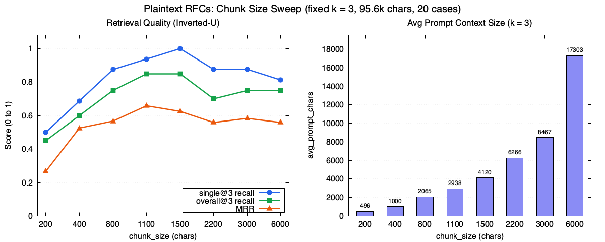
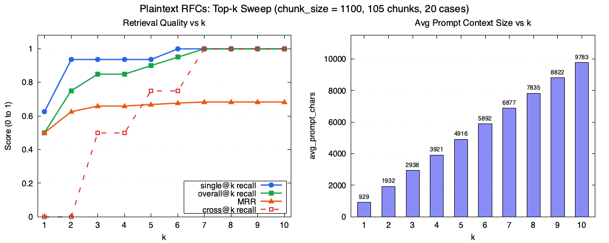

# Plaintext RFC Retrieval Sweeps

Empirical measurements of `chunk_size` and `k` on 3 complete IETF RFCs ([rfc6585.txt](../tests/fixtures_plain/rfc6585.txt), [rfc6750.txt](../tests/fixtures_plain/rfc6750.txt), [rfc7636.txt](../tests/fixtures_plain/rfc7636.txt) — **95,595 chars total**, 20 questions: 16 single-chunk + 4 cross-chunk), embedded with `text-embedding-3-small`.

RFCs are plaintext with no Markdown `#` headings, so the sweeps use the `Plain` chunker, which packs paragraphs up to `chunk_size`, isolating `chunk_size` and `k` from any structure-aware chunking. (`Markdown` produces identical chunks on these files, checked by `plain_chunker_matches_markdown_on_rfcs`.)

Raw data: [chunk_size.csv](chunk_size.csv) · [top_k.csv](top_k.csv) · Plot script: [plot.gp](plot.gp) (`gnuplot experiments/plot.gp`) · Runner: [tests/sweep.rs](../tests/sweep.rs)

---

## 1. Chunk Size Curve (fixed `k = 3`)

| `chunk_size` | `chunks` | `single@3` | `overall@3` | `MRR` | `avg_prompt_chars` | `ingest` |
| ---: | ---: | ---: | ---: | ---: | ---: | ---: |
| 200 | 632 | 8/16 (50%) | 9/20 (45%) | 0.267 | 496 | 11.0s |
| 400 | 320 | 11/16 (69%) | 12/20 (60%) | 0.525 | 1,000 | 3.0s |
| 800 | 148 | 14/16 (88%) | 15/20 (75%) | 0.567 | 2,065 | 1.7s |
| **1100** | **105** | **15/16 (94%)** | **17/20 (85%)** | **0.658** | **2,938** | **2.3s** |
| **1500** | **76** | **16/16 (100%)** | **17/20 (85%)** | **0.625** | **4,120** | **1.5s** |
| 2200 | 49 | 14/16 (88%) | 14/20 (70%) | 0.558 | 6,266 | 1.6s |
| 3000 | 35 | 14/16 (88%) | 15/20 (75%) | 0.583 | 8,467 | 1.4s |
| 6000 | 17 | 13/16 (81%) | 15/20 (75%) | 0.558 | 17,303 | 1.4s |

**Takeaways:**
- **Too small (`200–400` chars):** paragraphs fragment into ambiguous slices (`single@3` drops to 50%, `MRR` to `0.267`), spawning 632 chunks (`11.0s` ingest).
- **Sweet spot (`1100–1500` chars ≈ ~275–375 tokens):** `1100` peaks on `MRR` (`0.658`) with 29% fewer prompt chars than `1500`; `1500` peaks on `single@3` (`16/16 = 100%`), both tying on `overall@3` (`17/20 = 85%`).
- **Too large (`2200–6000` chars):** dilution hits already at `2200` (`overall@3` falls from `85% → 70%`, `MRR` from `0.658 → 0.558`), and by `6000` prompt size is **5.9×** larger than `1100` (`17,303` vs `2,938` chars) for worse retrieval.

---

## 2. Top-`k` Curve (fixed `chunk_size = 1100`, 105 chunks)

Fixing `chunk_size` at Experiment 1's MRR winner (`1100` chars) and sweeping `k = 1..=10`:

| `k` | `single@k` | `cross@k` | `overall@k` | `MRR` | `avg_prompt_chars` |
| ---: | ---: | ---: | ---: | ---: | ---: |
| 1 | 10/16 (63%) | 0/4 (0%) | 10/20 (50%) | 0.500 | 929 |
| 2 | 15/16 (94%) | 0/4 (0%) | 15/20 (75%) | 0.625 | 1,932 |
| **3** | **15/16 (94%)** | **2/4 (50%)** | **17/20 (85%)** | **0.658** | **2,938** |
| 4 | 15/16 (94%) | 2/4 (50%) | 17/20 (85%) | 0.658 | 3,921 |
| 5 | 15/16 (94%) | 3/4 (75%) | 18/20 (90%) | 0.668 | 4,916 |
| 6 | 16/16 (100%) | 3/4 (75%) | 19/20 (95%) | 0.677 | 5,892 |
| **7** | **16/16 (100%)** | **4/4 (100%)** | **20/20 (100%)** | **0.684** | **6,877** |
| 8 | 16/16 (100%) | 4/4 (100%) | 20/20 (100%) | 0.684 | 7,835 |
| 9 | 16/16 (100%) | 4/4 (100%) | 20/20 (100%) | 0.684 | 8,822 |
| 10 | 16/16 (100%) | 4/4 (100%) | 20/20 (100%) | 0.684 | 9,783 |

**Takeaways:**
- **Steep knee at `k = 1 → 3`:** `overall` jumps `50% → 75% → 85%` (`single` hits `15/16` by `k = 2`), and `k = 3` already captures **96% of final MRR** (`0.658 / 0.684`) at `2,938` prompt chars.
- **Diminishing returns (`k = 3 → 7`):** reaching `20/20 (100%)` (including all `4/4` cross-chunk cases) costs **2.3× more prompt chars** (`2,938 → 6,877`) for `+0.026` MRR.
- **Pure noise past saturation (`k = 7 → 10`):** prompt context grows another **+42%** (`6,877 → 9,783` chars) with zero recall or MRR gain.
